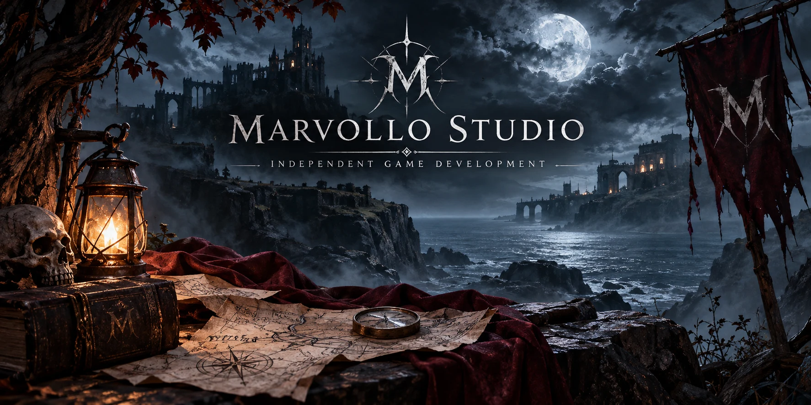
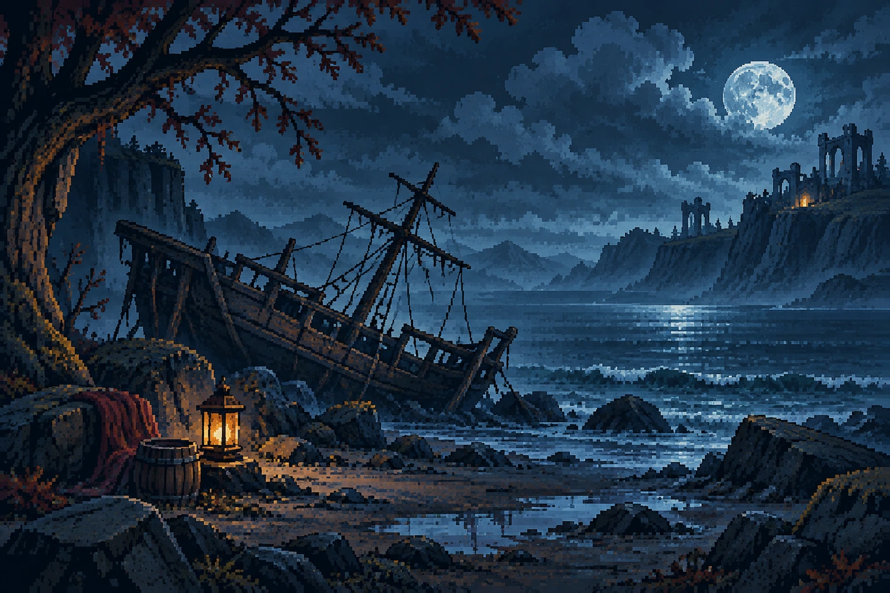

  
  <h1>MARVOLLO STUDIO</h1>
  
<strong>Independent Game Development</strong>

  
<em>Crafting worlds. Telling stories.</em>

  
  

 

## Our Worlds

### Saltshore

**Dark Fantasy RPG · In active development**

A narrative-driven world of exploration, survival and meaningful choices.

 

Concept artwork, not an in-game screenshot.

## Development Focus

- Narrative design and worldbuilding
- RPG mechanics and interactive systems
- Game art and user experience
- Development tools and automation

## Development Toolkit

`RPG Maker MZ` · `JavaScript` · `Python` · `Pixel Art` · `Git` · `Linux`

MARVOLLO STUDIO · EST. 2026

