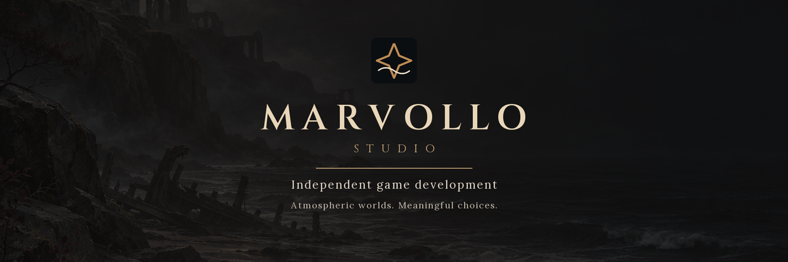
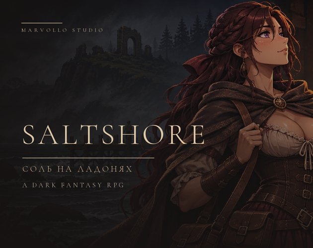

  
    
  
  <h1>MARVOLLO STUDIO</h1>
  
<strong>Independent game development</strong>

  
<em>Atmospheric worlds. Meaningful choices.</em>

  

    
    
  

## The studio

Marvollo Studio is an independent game development project focused on atmospheric, story-driven RPGs. We build dark fantasy worlds where exploration, survival and the consequences of your choices matter.

The studio identity is deliberately quiet: charcoal-brown surfaces, warm copper and antique gold, cinematic art, clear typography and as little interface noise as possible.

## Current project

  

### Saltshore

**Dark fantasy RPG · In development**

After surviving a shipwreck, Mira finds herself stranded on an unfamiliar shore. With limited resources and no clear path ahead, she must survive, explore the world around her and uncover what lies beyond the coastline.

- **Planned first public release:** December 31, 2026
- **Estimated playtime:** 1–2 hours
- **Price:** Free

  
  

## Development focus

- Narrative design and worldbuilding
- RPG systems, progression and choice
- Survival, crafting and exploration
- Cinematic art direction and interface design
- Development tools and automation

## Toolkit

  MARVOLLO STUDIO · INDEPENDENT GAME DEVELOPMENT · <a href="https://marvollostudio.com">marvollostudio.com</a>

