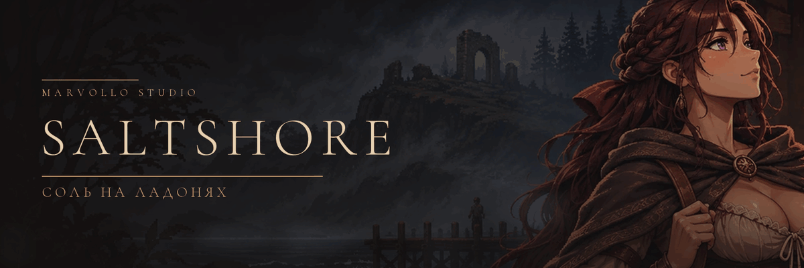
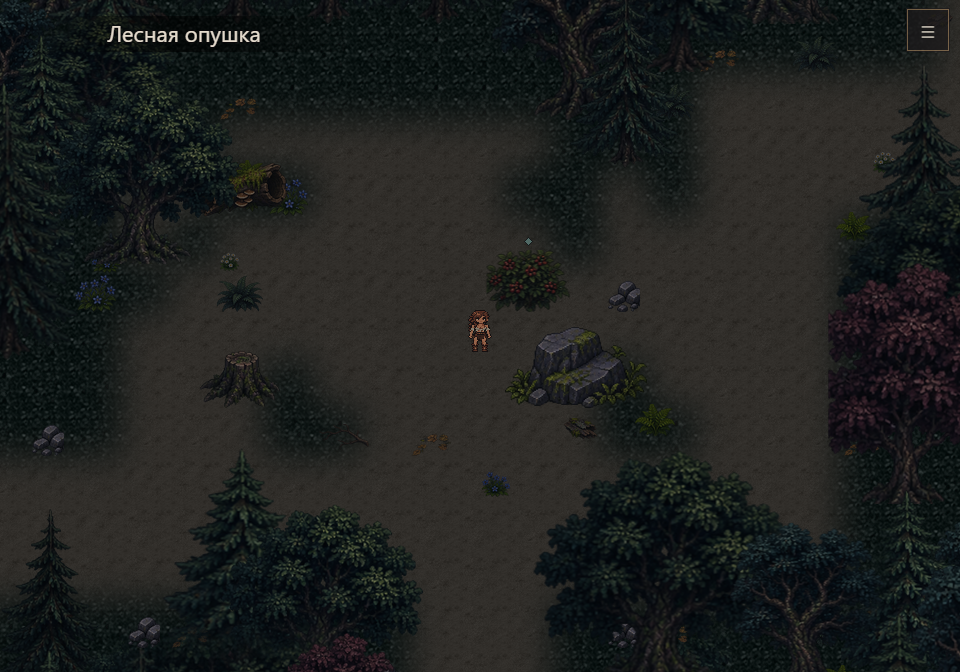
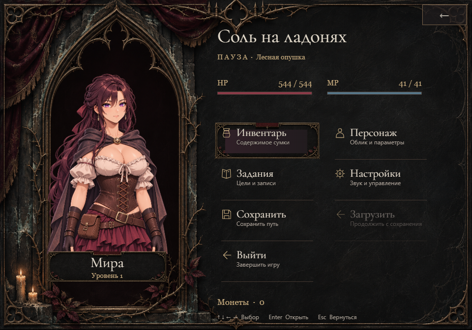

  

  <strong>Independent Game Development</strong> 
  <em>Atmospheric worlds. Meaningful choices.</em>

  Marvollo Studio is an independent game development project focused on atmospheric, story-driven RPGs. 
  We create worlds where exploration, character development and meaningful choices shape the player's journey.

  
  
  

<h2 align="center">Our Worlds</h2>

<em>One studio. Many worlds.</em>

  <a href="https://marvollostudio.itch.io/saltshore">
    <picture>
      <source media="(prefers-reduced-motion: reduce)" srcset="assets/saltshore/hero-fog-poster.png">
      
    </picture>
  </a>

### Saltshore / Соль на ладонях

A story-driven dark fantasy RPG about survival, discovery and the consequences of your choices.

After surviving a shipwreck, Mira finds herself stranded on an unfamiliar shore. Her journey is shaped by exploration, character development and the decisions she makes.

**Genre:** Dark Fantasy RPG · **Status:** In development  
**Planned first release:** December 31, 2026 · **Initial version content:** approximately 1–2 hours  
**Distribution:** Free · **Audience:** 18+

The first public version is a focused 1–2 hour experience. The full game will be significantly larger and will continue to evolve after release.

  
  

#### From the current build

Actual in-game frames from the Russian-language development build. English localization is not confirmed.

  
  

## Development Focus

- Narrative design and worldbuilding
- RPG mechanics and interactive systems
- Game art and user experience
- Development tools and automation

MARVOLLO STUDIO · EST. 2026

